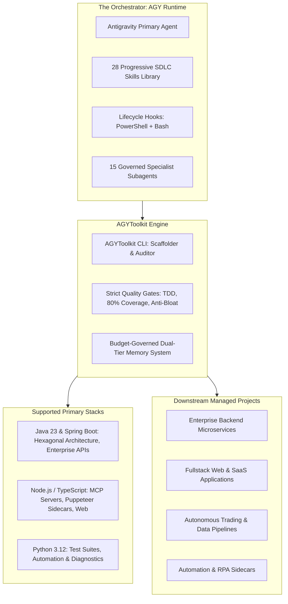

# AGYToolkit

> **The Sovereign Multi-Agent AI Development Framework & SDLC Operating System for Google Antigravity (AGY).**

`AGYToolkit` is an enterprise-grade multi-agent governance and development framework. It provides deterministic lifecycle hooks, strict quality gates, a universal 15-specialist agent matrix, 28 progressive SDLC skills, and a budget-governed memory system to empower autonomous agent swarms in delivering production-grade software across any repository.

---

## Framework Architecture



---

## Core Governance Pillars

1. **15 Universal Specialist Subagents**:
   - `orchestrator`, `planner-architect`, `spring-boot-engineer`, `node-ts-engineer`, `python-automation-lead`, `frontend-ui-engineer`, `database-architect`, `tdd-specialist`, `security-auditor`, `code-reviewer`, `anti-bloat-sentinel`, `git-craftsman`, `docs-librarian`, `context-budget-guard`, `dependency-curator`.
   - Each agent operates under the Single Responsibility Principle with strict handoff contracts, workspace isolation modes (`inherit`, `branch`, `share`), and explicit Definitions of Done.

2. **28 Progressive SDLC Skills**:
   - Loaded on demand to conserve prompt tokens. Organized into 5 engineering tracks: Planning & Architecture, TDD & Implementation, Review & Quality Gates, Git & CI/CD, and Meta-Framework Extensibility (including on-demand domain skill/agent authoring).

3. **Lifecycle Hooks (`hooks.json`)**:
   - Automated runtime gates executed before and after tool calls (`PreToolUse`, `PostToolUse`, `SessionStart`).
   - Hard blocks on direct commits to `main`, unapproved file modifications, and failing test runs.

4. **Anti-Bloat Sentinel**:
   - Zero emojis in production code, comments, or log strings.
   - Elimination of conversational AI chatter in source comments.
   - Strict prohibition of monolithic single-file dumps (>600 line limit).

5. **Budget-Governed Memory Engine**:
   - `active-session.md`: 1 KB hard budget for working context (gitignored).
   - `decisions.md`: 3 KB hard budget for committed architectural decisions.
   - `volatile-bus/`: Ephemeral dump zone for raw logs >20 lines (gitignored).
   - Guarantees seamless `/compact` operations with zero context loss.

6. **Universal Project Initializer**:
   - `agy-toolkit init` command to bootstrap any downstream repository with complete governance, agent specifications, skills, and lifecycle hooks in seconds.

---

## Quickstart & CLI Usage

### Installation
```bash
git clone https://github.com/OneEyedDragon1102/AGYToolkit.git
cd AGYToolkit
python -m venv .venv
.\.venv\Scripts\Activate.ps1  # or source .venv/bin/activate on Linux/macOS
pip install -e .
```

### CLI Commands
```bash
# List all 28 progressive SDLC skills across 5 tracks
agy-toolkit --list-skills

# List all 15 universal specialist subagents
agy-toolkit --list-agents

# List supported tool categories
agy-toolkit --list-tools

# Scaffold governance into a target project
agy-toolkit init ../my-service --name my-service --stack spring-boot --mode feature
```

---

## Repository Structure

```text
AGYToolkit/
├── pyproject.toml               # Python package manifest & CLI script entrypoint
├── README.md                    # Framework manual (this file)
├── AGENTS.md                    # Operational protocols for AGY agents
├── GEMINI.md                    # Core project rules & coding standards
│
├── templates/                   # Distributable blueprints deployed to downstream repos
│   ├── .agents/
│   │   ├── agents/              # 15 Universal Specialist Subagents (Markdown specs)
│   │   ├── hooks/               # Lifecycle hook scripts (PS1 + Bash)
│   │   ├── hooks.json           # Active AGY event hook triggers
│   │   ├── skills/              # 28 Progressive SDLC Skills
│   │   └── memory/              # Memory templates (active-session, decisions, volatile-bus)
│   └── rules/
│       ├── GEMINI.md.template   # Injected project rules
│       └── AGENTS.md.template   # Injected agent instructions
│
├── automation/                  # Framework CLI, core engines & verification
│   ├── src/agy_toolkit/         # Core Python package (cli, scaffolder, memory, agents)
│   └── tests/                   # 34 automated unit & verification tests
│
└── docs/                        # Complete technical framework documentation
    ├── getting_started.md       # Onboarding, installation, and usage guide
    ├── specialist_agents.md     # In-depth reference for all 15 agents
    ├── skills_catalog.md        # Comprehensive catalog of all 28 skills
    ├── memory_system.md         # Architecture of the dual-tier memory engine
    └── core_tools.md            # AGY tool definitions and parameter reference
```

---

## Documentation Reference

- [Getting Started Guide](docs/getting_started.md)
- [Specialist Agents Reference](docs/specialist_agents.md)
- [Progressive Skills Catalog](docs/skills_catalog.md)
- [Memory System Architecture](docs/memory_system.md)
- [Core Tool Catalog](docs/core_tools.md)

---

## License
MIT
