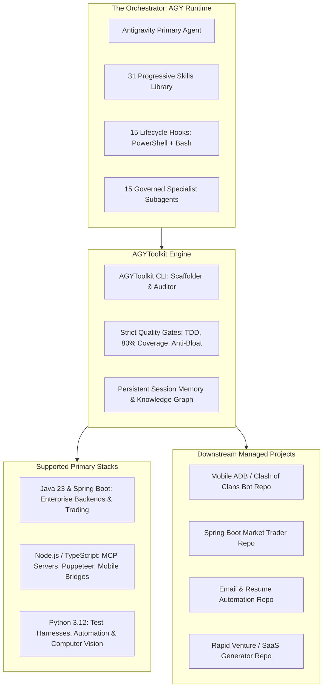

# 🛠️ AGYToolkit

> **The Sovereign Multi-Agent AI Development Framework & SDLC Operating System for Google Antigravity (AGY).**

`AGYToolkit` is an enterprise-grade multi-agent governance and development framework (inspired by *AllStackDeveloper*). It is designed to govern, scaffold, test, and drive the autonomous delivery of software projects across independent repositories (Trading Bots, Mobile/Gaming Automators, Productivity Agents, and SaaS MVPs).

---

## 🏛️ Framework Architecture



---

## ⚡ Core Governance Pillars

1. **15 Governed Specialist Agents**:
   - `orchestrator`, `planner-architect`, `spring-boot-engineer`, `node-ts-engineer`, `python-automation-lead`, `tdd-specialist`, `security-auditor`, `code-reviewer`, `anti-bloat-sentinel`, `adb-device-master`, `quant-market-analyst`, `docs-librarian`, `git-craftsman`, `context-budget-guard`, `dependency-curator`.
2. **31 Progressive Skills**:
   - Categorized into Planning & Architecture, Test-Driven Development, Quality & Anti-Bloat, Git & Workflow, and Domain Automation Engines.
3. **15 Cross-Platform Lifecycle Hooks (`hooks.json`)**:
   - Automated runtime gates executed before and after tool calls (e.g. `PreToolUse`, `PostToolUse`, `SessionStart`).
   - Hard blocks on direct commits to `main`, unapproved code generation, and test failures.
4. **Anti-Bloat Sentinel**:
   - Eliminates typical AI-generated noise: zero emojis in production code, no oversized conversational comments, and strict prohibition of monolithic single-file dumps.
5. **Universal Project Initializer**:
   - `agy-toolkit init` command to bootstrap any downstream repository with full governance, skills, and lifecycle hooks in seconds.

---

## 📁 Repository Structure

```text
AGYToolkit/
├── .agents/
│   ├── rules/                   # Contextual rules (code style, anti-bloat, security)
│   ├── skills/                  # The 31 Progressive Skills library
│   └── hooks.json               # AGY lifecycle event hook definitions
├── hooks/                       # Cross-platform lifecycle hook scripts (PS1 + Bash)
│   ├── plan-approval-gate.ps1
│   ├── enforce-branch-rule.ps1
│   ├── anti-bloat-check.ps1
│   └── ...
├── agents/                      # 15 Specialist Subagent definitions & prompts
│   ├── orchestrator.md
│   ├── planner-architect.md
│   └── ...
├── templates/                   # Scaffolding templates for downstream repositories
│   ├── spring-boot/             # Enterprise Spring Boot template
│   ├── node-ts/                 # Node.js MCP / TypeScript template
│   └── python-automation/       # Python CV / automation template
├── automation/                  # Test harnesses, CLI utility & diagnostics
│   ├── src/agy_toolkit/         # Framework CLI & core logic
│   └── tests/                   # Automated hook & agent test suites
├── AGENTS.md                    # Core operational agent instructions
├── GEMINI.md                    # Mandatory development rules & governance
└── README.md                    # Framework manual (this file)
```

---

## 🔄 The Weekend-Weekday Development Rhythm

| Cadence | Role | Autonomous Operations |
| :--- | :--- | :--- |
| **Weekend Forge** (Heavy Dev) | Full SDLC velocity with subagents, architectural planning, TDD implementation, and security auditing. |
| **Weekday Machine** (Profit & Autonomy) | Headless running of downstream projects: automated trading, mobile game farming, email triage, and lead generation. |

---

## 📄 License
MIT
