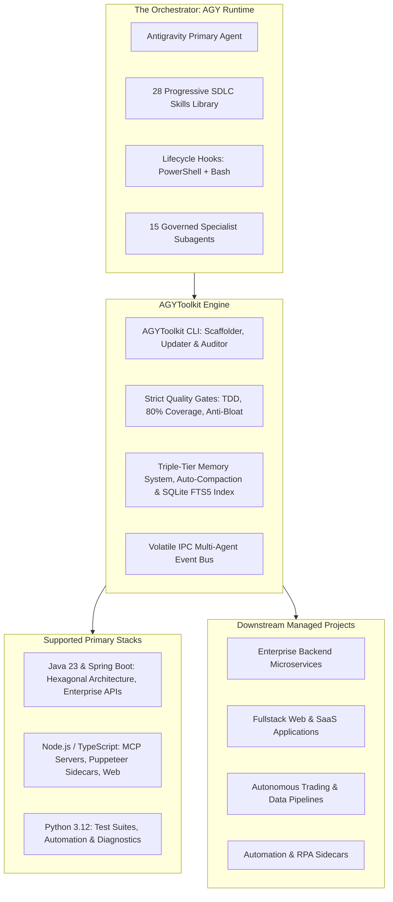

# AGYToolkit

> **The Sovereign Multi-Agent AI Development Framework & SDLC Operating System for Google Antigravity (AGY).**

`AGYToolkit` is an enterprise-grade multi-agent governance and development framework. It provides deterministic lifecycle hooks, strict quality gates, a universal 15-specialist agent matrix, 28 progressive SDLC skills, and a budget-governed memory system to empower autonomous agent swarms in delivering production-grade software across any repository.

---

## Framework Architecture



---

## Core Governance Pillars

1. **15 Universal Specialist Subagents**:
   - `orchestrator`, `planner-architect`, `spring-boot-engineer`, `node-ts-engineer`, `python-automation-lead`, `frontend-ui-engineer`, `database-architect`, `tdd-specialist`, `security-auditor`, `code-reviewer`, `anti-bloat-sentinel`, `git-craftsman`, `docs-librarian`, `context-budget-guard`, `dependency-curator`.
   - Each agent operates under the Single Responsibility Principle with strict handoff contracts, workspace isolation modes (`inherit`, `branch`, `share`), and explicit Definitions of Done.

2. **28 Progressive SDLC Skills**:
   - Loaded on demand to conserve prompt tokens. Organized into 5 engineering tracks: Planning & Architecture, TDD & Implementation, Review & Quality Gates, Git & CI/CD, and Meta-Framework Extensibility (including on-demand domain skill/agent authoring).

3. **Lifecycle Hooks (`hooks.json`)**:
   - Automated runtime gates executed before and after tool calls (`PreToolUse`, `PostToolUse`, `SessionStart`).
   - Hard blocks on direct commits to `main`, unapproved file modifications, monolithic code dumps, and failing test runs.
   - Background file-touch tracking and threshold-based auto-compaction on `PostToolUse`.

4. **Anti-Bloat Sentinel**:
   - Zero emojis in production code, comments, or log strings.
   - Elimination of conversational AI chatter in source comments.
   - Strict prohibition of monolithic single-file dumps (>600 line limit).

5. **Budget-Governed Triple-Tier Memory Engine & Permanent Knowledge Index**:
   - `active-session.md`: 1 KB hard budget for working context (gitignored).
   - `decisions.md`: 3 KB hard budget for committed architectural decisions.
   - `volatile-bus/`: Ephemeral dump zone and inter-agent IPC message bus (gitignored).
   - `knowledge.db`: Zero-dependency SQLite FTS5 full-text search engine indexing historical ADRs, sessions, and project rules for sub-millisecond retrieval.
   - **Autonomous Compaction**: When memory usage crosses 85% of capacity, the engine archives full snapshots to `.agents/memory/sessions/`, prunes working memory to essential goals/blockers, evicts oldest decisions via FIFO to `docs/adr/decisions-history.md`, and automatically syncs the Tier 3 knowledge index.
   - Guarantees seamless `/compact` operations with zero context loss and eliminates project amnesia.

6. **Universal Project Initializer, Turnkey Starters & Health Diagnostics**:
   - `agy-toolkit init`: Bootstrap any downstream repository with complete governance in seconds.
   - **Turnkey Production Starters (`--template`)**:
     - `spring-boot-hexagonal`: Java 23 / Spring Boot 3.3+ Hexagonal architecture with domain models, inbound REST ports, JPA adapters, and Testcontainers.
     - `node-clean-ts`: Node.js / TypeScript microservice with Fastify, Zod validation, Vitest test suite, and multi-stage Dockerfile.
     - `python-fastapi`: Python 3.12+ async service with FastAPI, Pydantic v2, pytest suite, and ruff linting.
   - `agy-toolkit update`: Non-destructively refresh skills, agents, and hooks in existing workspaces while preserving custom rules and memory.
   - `agy-toolkit doctor`: Deep environment and workspace compliance auditor.

7. **Autonomous Swarm Choreography & Declarative DAG Engine**:
   - `agy-toolkit swarm`: Coordinates multi-step autonomous workflows across the 15 specialist subagents over the volatile event bus.
   - Declarative blueprints: `feature-sdlc` (5 steps), `code-review` (3 steps), and `quickfix` (3 steps) with stack-aware specialization (`spring-boot`, `node-ts`, `python`).
   - Self-healing task leases, heartbeat renewals, crash recovery, and automated upstream context propagation.
   - Autonomous Swarm Worker Daemon (`agy-toolkit swarm worker`): Automatically claims dispatched DAG tasks, runs heartbeat supervisors, executes specialist work, and advances pipeline state hands-free.

---

## Quickstart & CLI Usage

### Installation
```bash
git clone https://github.com/OneEyedDragon1102/AGYToolkit.git
cd AGYToolkit
python -m venv .venv
.\.venv\Scripts\Activate.ps1  # or source .venv/bin/activate on Linux/macOS
pip install -e .
```

### CLI Commands
```bash
# Run environment & governance health audit
agy-toolkit doctor

# Mount all 28 skills and 15 agents machine-wide into ~/.gemini/config/
agy-toolkit link-global

# List available turnkey production stack templates
agy-toolkit --list-templates

# Scaffold governance only into a target project
agy-toolkit init ../my-service --name my-service --stack spring-boot --mode feature

# Scaffold turnkey compiling production starters
agy-toolkit init ../order-service --name order-service --template spring-boot-hexagonal
agy-toolkit init ../auth-gateway --name auth-gateway --template node-clean-ts
agy-toolkit init ../payment-service --name payment-service --template python-fastapi

# Update skills, agents, and hooks in downstream project non-destructively
agy-toolkit update ../my-service

# Preview updates in dry-run mode
agy-toolkit update ../my-service --dry-run

# Check active session and decisions memory budgets
agy-toolkit memory status

# Full-text search across historical ADRs, archived sessions, and rules
agy-toolkit memory search "Hexagonal Architecture"

# Search with specific category filter (e.g. ARCH, BUS, SEC, SESSION)
agy-toolkit memory search "volatile bus" --category BUS

# Rebuild or sync the permanent SQLite FTS5 knowledge search index
agy-toolkit memory reindex

# Auto-compact active session and archive oldest decisions (85% threshold)
agy-toolkit memory auto-compact

# Preview auto-compaction projections without writing
agy-toolkit memory auto-compact --dry-run

# Flush active session and archive to sessions/
agy-toolkit memory flush

# Start native Antigravity MCP Server over stdio (18 native tools)
agy-toolkit mcp

# Export static MCP tool schemas for Antigravity discovery
agy-toolkit mcp --export-schemas .agents/mcp/agy-toolkit/

# Publish inter-agent event to volatile bus
agy-toolkit bus send --topic review --sender code-reviewer --recipient orchestrator --payload '{"status": "PASS"}'

# Stream and watch incoming events in real time
agy-toolkit bus watch --topic review --timeout 60

# List standard swarm blueprint catalogs
agy-toolkit swarm pipelines

# Launch autonomous swarm pipeline run with stack specialization
agy-toolkit swarm run feature-sdlc --stack spring-boot --context '{"issue": 101}'

# Query real-time execution topology and status card
agy-toolkit swarm status <run_id>

# Advance pipeline step and unlock downstream dependencies
agy-toolkit swarm advance <run_id> --step plan --status COMPLETED --result '{"spec": "approved"}'

# Inspect terminal cockpit dashboard with swarm telemetry
agy-toolkit dashboard

# Run a single autonomous swarm worker cycle
agy-toolkit swarm worker --run-once

# Run autonomous PR review and diff audit locally
agy-toolkit pr-review --base origin/main

# List all 28 progressive SDLC skills across 5 tracks
agy-toolkit --list-skills

# List all 15 universal specialist subagents
agy-toolkit --list-agents

# List supported tool categories
agy-toolkit --list-tools
```

---

## Repository Structure

```text
AGYToolkit/
├── pyproject.toml               # Python package manifest & CLI script entrypoint
├── README.md                    # Framework manual (this file)
├── AGENTS.md                    # Operational protocols for AGY agents
├── GEMINI.md                    # Core project rules & coding standards
│
├── templates/                   # Distributable blueprints deployed to downstream repos
│   ├── .agents/
│   │   ├── agents/              # 15 Universal Specialist Subagents (Markdown specs)
│   │   ├── hooks/               # Lifecycle hook scripts (PS1 + Bash)
│   │   ├── hooks.json           # Active AGY event hook triggers
│   │   ├── skills/              # 28 Progressive SDLC Skills
│   │   └── memory/              # Memory templates (active-session, decisions, volatile-bus)
│   ├── rules/
│   │   ├── GEMINI.md.template   # Injected project rules
│   │   └── AGENTS.md.template   # Injected agent instructions
│   └── stacks/                  # Turnkey production starter templates
│       ├── spring-boot-hexagonal/  # Java 23 / Spring Boot 3.3+ Hexagonal architecture
│       ├── node-clean-ts/          # Node.js / TypeScript / Fastify / Vitest
│       └── python-fastapi/         # Python 3.12+ / FastAPI / Pydantic v2 / pytest
│
├── automation/                  # Framework CLI, core engines & verification
│   ├── src/agy_toolkit/         # Core Python package (cli, knowledge, mcp_knowledge, scaffolder, scaffolder_stacks, memory, bus, doctor, linker, mcp, updater)
│   └── tests/                   # 172 automated unit & verification tests
│
└── docs/                        # Complete technical framework documentation
    ├── getting_started.md       # Onboarding, installation, and usage guide
    ├── mcp_server.md            # Native Antigravity MCP Server setup & 18-tool reference
    ├── ci_cd_governance.md      # CI/CD pipeline and PR review bot guide
    ├── specialist_agents.md     # In-depth reference for all 15 agents
    ├── skills_catalog.md        # Comprehensive catalog of all 28 skills
    ├── memory_system.md         # Triple-tier memory engine, auto-compact, FTS5 knowledge search & event bus
    └── core_tools.md            # AGY tool definitions and parameter reference
```

---

## Documentation Reference

- [Getting Started Guide](docs/getting_started.md)
- [Native Antigravity MCP Server](docs/mcp_server.md)
- [Memory System & Auto-Compaction](docs/memory_system.md)
- [CI/CD Governance & PR Review Bot](docs/ci_cd_governance.md)
- [Specialist Agents Reference](docs/specialist_agents.md)
- [Progressive Skills Catalog](docs/skills_catalog.md)
- [Core Tools Reference](docs/core_tools.md)
