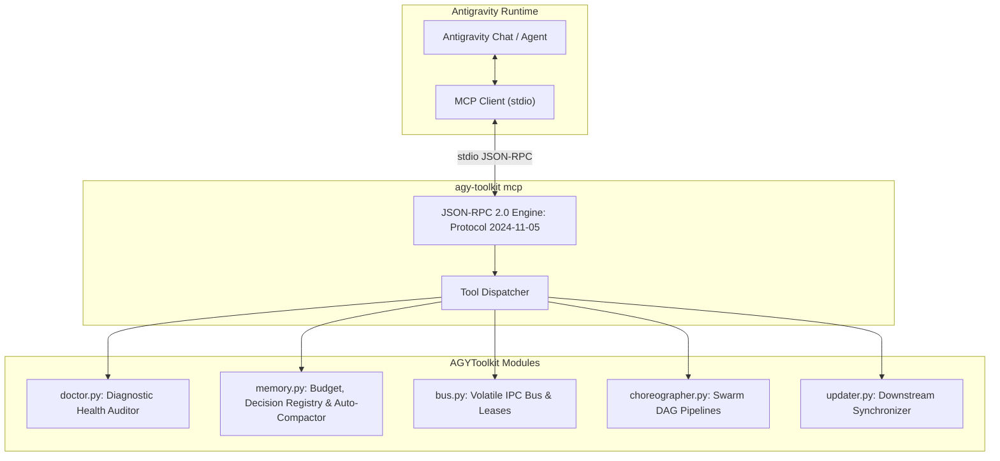

# AGYToolkit Native Antigravity MCP Server (`agy-mcp`)

The **AGYToolkit MCP Server** provides native Model Context Protocol (MCP) integration over standard input/output (`stdio`), exposing core toolkit governance, dual-tier memory budgets, dynamic memory auto-compaction, multi-agent volatile IPC, and autonomous DAG pipeline swarm choreography directly to Google Antigravity agents.

---

## 1. Architecture Overview



The MCP server is implemented entirely using the Python standard library with **zero external dependencies**, adhering to the official **MCP 2024-11-05** protocol specification.

---

## 2. Configuration for Antigravity

To register AGYToolkit as an active MCP server in your Antigravity environment, add the following entry to your Antigravity configuration file (e.g. `~/.gemini/antigravity.json` or `.gemini/settings.json`):

```json
{
  "mcpServers": {
    "agy-toolkit": {
      "command": "agy-toolkit",
      "args": ["mcp"]
    }
  }
}
```

If running directly from the Python repository source without global packaging:

```json
{
  "mcpServers": {
    "agy-toolkit": {
      "command": "python",
      "args": ["-m", "agy_toolkit.cli", "mcp"]
    }
  }
}
```

---

## 3. Tool Catalog Reference

The MCP server exposes sixteen native tools:

### `agy_doctor`
* **Description**: Runs a diagnostic health check and governance audit on the environment.
* **Arguments**:
  - `strict` *(boolean, optional, default: `false`)*: Enforce strict zero-warning mode for CI/CD gates.
* **Output**: Formatted markdown audit report detailing toolchain, hook, and memory status.

### `agy_memory_status`
* **Description**: Queries memory budget consumption and cap thresholds.
* **Arguments**: None.
* **Output**: Byte usage and pass/fail thresholds for `active-session.md` (1 KB cap) and `decisions.md` (3 KB cap).

### `agy_memory_record`
* **Description**: Appends a binding architectural decision to `decisions.md` within budget.
* **Arguments**:
  - `decision` *(string, required)*: The architectural decision statement.
  - `category` *(string, optional, default: `"ARCH"`)*: Category prefix (e.g. `ARCH`, `GOV`, `DIST`, `BUS`, `TDD`).
* **Output**: Confirmation message with recorded entry.

### `agy_memory_compact`
* **Description**: Evaluates active session and architectural decision budgets, archiving bloated snapshots and offloading oldest decisions to cold storage.
* **Arguments**:
  - `threshold` *(number, optional, default: `0.85`)*: Compaction threshold ratio (0.0 - 1.0) above which auto-compaction is triggered.
  - `dry_run` *(boolean, optional, default: `false`)*: Preview compaction actions and byte projections without modifying files on disk.
* **Output**: Formatted auto-compaction report detailing bytes before/after, archive paths, and runtime advice for AGY agents.

### `agy_bus_send`
* **Description**: Publishes a structured JSON event envelope to the volatile multi-agent IPC bus.
* **Arguments**:
  - `topic` *(string, required)*: Channel topic name (e.g. `task-handoff`, `lint-alert`).
  - `source` *(string, required)*: Sender agent identifier.
  - `payload` *(object, required)*: Structured dictionary payload for the event.
  - `recipient` *(string, optional, default: `"*"`)*: Destination agent identifier.
  - `ttl_seconds` *(integer, optional, default: `3600`)*: Event time-to-live before expiration.
* **Output**: Created event ID, topic, and expiration details.

### `agy_bus_read`
* **Description**: Reads and lists active non-expired events from the volatile IPC bus.
* **Arguments**:
  - `topic` *(string, optional)*: Filter events by topic name.
  - `limit` *(integer, optional, default: `10`)*: Maximum number of events to return.
* **Output**: JSON array of matching event envelopes.

### `agy_bus_claim`
* **Description**: Atomically claims an event from the volatile bus with a lease duration to prevent duplicate processing by competing agents.
* **Arguments**:
  - `event_id` *(string, required)*: The unique ID of the event envelope to claim.
  - `claimer` *(string, required)*: Identifier of the claiming agent.
  - `lease_seconds` *(integer, optional, default: `300`)*: Initial lease duration in seconds.
* **Output**: Claimed event payload or error if already claimed.

### `agy_bus_heartbeat`
* **Description**: Extends the active claim lease for a task on the volatile bus to signal agent liveness during long-running tasks.
* **Arguments**:
  - `event_id` *(string, required)*: The unique ID of the claimed event.
  - `claimer` *(string, required)*: Identifier of the claiming agent.
  - `extend_seconds` *(integer, optional)*: New lease duration in seconds.
* **Output**: Confirmation message of lease renewal or lock error.

### `agy_bus_reclaim`
* **Description**: Sweeps and recovers expired or orphaned claims on the volatile bus, returning tasks to the unassigned queue with audit provenance.
* **Arguments**:
  - `grace_seconds` *(number, optional, default: `0.0`)*: Grace period beyond expiration before forced reclamation.
* **Output**: Count and identifiers of reclaimed tasks.

### `agy_swarm_run`
* **Description**: Launches a new autonomous multi-agent DAG pipeline run across specialist subagents.
* **Arguments**:
  - `pipeline` *(string, required)*: Blueprint name (`feature-sdlc`, `code-review`, `quickfix`).
  - `stack` *(string, optional, choices: `spring-boot`, `node-ts`, `python`)*: Tech stack specialization.
  - `context` *(object, optional)*: Initial context payload dictionary.
* **Output**: JSON representation of the initialized pipeline run and initial dispatched step.

### `agy_swarm_status`
* **Description**: Queries execution topology, step status, and progress of a multi-agent pipeline run.
* **Arguments**:
  - `run_id` *(string, required)*: Unique pipeline run identifier.
* **Output**: JSON structure detailing each step's state, assigned role, event ID, claimer, and error if any.

### `agy_swarm_advance`
* **Description**: Transitions step status in a pipeline run and automatically unlocks downstream dependent steps with upstream context handoffs.
* **Arguments**:
  - `run_id` *(string, required)*: Pipeline run identifier.
  - `step` *(string, required)*: Step name to transition.
  - `status` *(string, required, choices: `COMPLETED`, `FAILED`, `CLAIMED`)*: New step state.
  - `result` *(any, optional)*: Step output payload to propagate downstream.
  - `error` *(string, optional)*: Error message if step failed.
  - `claimer` *(string, optional)*: Agent identifier reporting progress.
* **Output**: Updated pipeline run state with newly dispatched downstream steps.

### `agy_swarm_cancel`
* **Description**: Cancels an active multi-agent pipeline run, marking pending steps as SKIPPED.
* **Arguments**:
  - `run_id` *(string, required)*: Pipeline run identifier.
  - `reason` *(string, optional, default: `"Operator cancelled via MCP"`)*: Reason for cancellation.
* **Output**: Cancellation confirmation message.

### `agy_swarm_worker_cycle`
* **Description**: Executes a single atomic worker claim, execution, and advance sweep across ready DAG pipeline steps.
* **Arguments**:
  - `timeout_seconds` *(integer, optional, default: `300`)*: Step execution timeout.
  - `command_override` *(string, optional)*: Explicit shell command override to execute for the step.
* **Output**: Execution outcome dictionary detailing step status, output, and execution duration.

### `agy_swarm_worker_status`
* **Description**: Inspects swarm worker daemon readiness and lists all unassigned dispatched pipeline steps on the volatile bus.
* **Arguments**: None.
* **Output**: Worker availability status and list of pending pipeline steps.

### `agy_update`
* **Description**: Non-destructively synchronizes the workspace's skills, agents, and hooks from latest blueprints while preserving custom rules and memory.
* **Arguments**:
  - `dry_run` *(boolean, optional, default: `false`)*: Preview changes without modifying the filesystem.
  - `force_rules` *(boolean, optional, default: `false`)*: Force refresh project rules (`GEMINI.md`, `AGENTS.md`) from templates.
* **Output**: Formatted summary report of refreshed components.

---

## 4. CLI Usage & Schema Export

### Starting the Server
Start the stdio JSON-RPC loop:
```bash
agy-toolkit mcp
```

### Exporting Static Schemas
To export static JSON tool definition files into an Antigravity MCP directory:
```bash
agy-toolkit mcp --export-schemas .agents/mcp/agy-toolkit/
```
Output:
```text
[AGYToolkit MCP] Exported 16 MCP tool schemas to .../.agents/mcp/agy-toolkit
  * agy_doctor.json
  * agy_memory_status.json
  * agy_memory_record.json
  * agy_memory_compact.json
  * agy_bus_send.json
  * agy_bus_read.json
  * agy_bus_claim.json
  * agy_bus_heartbeat.json
  * agy_bus_reclaim.json
  * agy_swarm_run.json
  * agy_swarm_status.json
  * agy_swarm_advance.json
  * agy_swarm_cancel.json
  * agy_swarm_worker_cycle.json
  * agy_swarm_worker_status.json
  * agy_update.json
```
