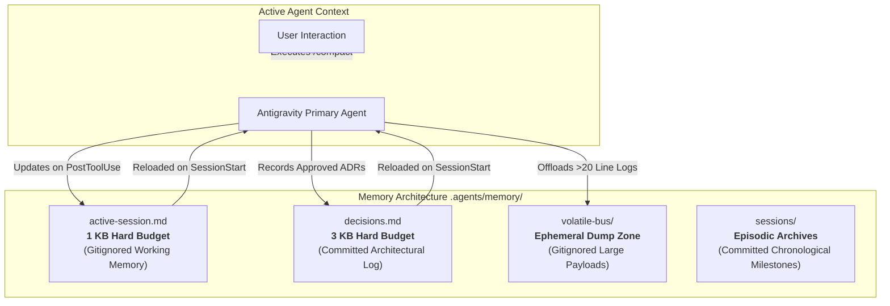

# The AGYToolkit Memory System

## Overview

In long-running autonomous development sessions, large context windows eventually encounter token exhaustion. When developers or agents execute `/compact` or when models truncate context, volatile knowledge (file touchpoints, decisions, active goals) is often erased, forcing agents to re-explore the codebase and repeat mistakes.

AGYToolkit solves this through a **budget-governed, dual-tier memory system** coupled with an ephemeral volatile bus. This guarantees that sessions can be compacted with **zero context loss**.

---

## Memory Architecture



---

## The Four Tiers Explained

### 1. `active-session.md` (Local Working Memory)
- **Path**: `.agents/memory/active-session.md`
- **Git Status**: **Strictly Gitignored**. Each developer or autonomous machine maintains its own active session state without causing merge conflicts.
- **Budget**: **Hard ceiling of 1024 bytes (1 KB)**.
- **Content**:
  - Current Objective & Branch.
  - Active Operational Mode (`FEATURE`, `SPIKE`, or `QUICKFIX`).
  - Active Touchpoints (the 3-5 files currently under modification).
  - Immediate Next Action.
- **Enforcement**: Monitored by `context-budgeter` and validated during `PostToolUse` memory flush hooks. If the file exceeds 1024 bytes, non-essential lines are trimmed automatically.

### 2. `decisions.md` (Project Architectural Memory)
- **Path**: `.agents/memory/decisions.md`
- **Git Status**: **Committed to Version Control**. Shared across all developers, agents, and CI pipelines.
- **Budget**: **Hard ceiling of 3072 bytes (3 KB)**.
- **Content**:
  - Date-stamped architectural decisions.
  - Pattern selections (e.g., Hexagonal Architecture, Zod schema validation).
  - Explicit trade-offs accepted.
  - Pointers to comprehensive ADR documents (`docs/adr/ADR-001-...`).
- **Enforcement**: Only updated when decisions are reviewed or confirmed. Older decisions are summarized or offloaded to ADR documents when approaching the 3 KB threshold.

### 3. `volatile-bus/` (Ephemeral Dump Zone & IPC)
- **Path**: `.agents/memory/volatile-bus/`
- **Git Status**: **Strictly Gitignored** (except `.gitignore`).
- **Purpose**: Prevents prompt token depletion and serves as the multi-agent IPC message bus.
- **Protocol**:
  - Any compiler output, stack trace, test log, or subagent research dump exceeding **20 lines** must never be printed directly into the chat thread.
  - Inter-agent messages and handoff events are written as structured JSON envelopes with configurable TTL expiration.

### 4. `sessions/` (Episodic Archive)
- **Path**: `.agents/memory/sessions/`
- **Git Status**: **Committed to Version Control**.
- **Purpose**: Historical log of completed milestones.
- **Protocol**: When a feature branch is merged or a major milestone is reached, `agy-toolkit memory flush` archives the active session state as a timestamped markdown file in `sessions/`, and `active-session.md` is reset to a clean baseline.

---

## Compaction Defense Protocol

When a conversation history grows and you run `/compact`:

1. **Pre-Compaction**:
   - The agent ensures all recent architectural decisions are recorded in `.agents/memory/decisions.md`.
   - The active task and touched files are confirmed in `.agents/memory/active-session.md`.
2. **Context Compaction**:
   - The LLM summarizer truncates conversational turns.
3. **Post-Compaction Wakeup**:
   - The agent reads `active-session.md` and `decisions.md` (consuming less than 4 KB combined).
   - The agent immediately knows the active branch, the touched files, and the next steps without needing to ask the user or search the repository.

---

## Memory & Event Bus CLI Commands

AGYToolkit provides CLI commands to govern memory budgets and pass messages across agents without context pollution:

### Memory Governance
```bash
# Check current memory usage against hard caps (1 KB active-session / 3 KB decisions)
agy-toolkit memory status

# Output metrics in JSON format for automation
agy-toolkit memory status --json

# Flush working memory and archive state into sessions/ directory
agy-toolkit memory flush

# Flush working memory without archiving
agy-toolkit memory flush --no-archive

# Record a binding architectural decision
agy-toolkit memory record --category ARCH --decision "Spring Boot microservices must use Hexagonal Architecture."
```

### Multi-Agent Event Bus (IPC)
```bash
# Publish an event to the volatile bus
agy-toolkit bus send --topic review --sender code-reviewer --recipient node-ts-engineer --payload '{"status": "APPROVED", "findings": 0}'

# List active events on the bus
agy-toolkit bus list

# Read and consume events matching a specific topic
agy-toolkit bus read --topic review --consume

# Clear all volatile bus payloads
agy-toolkit bus clear
```

---

## Programmatic Python API

Both memory budgets and the volatile bus can be manipulated programmatically:

### Memory Operations (`agy_toolkit.memory`)
```python
from pathlib import Path
from agy_toolkit.memory import (
    check_memory_budgets,
    update_active_session,
    flush_active_session,
    record_decision,
)

mem_dir = Path(".agents/memory")

# Check memory health
budgets = check_memory_budgets(mem_dir)
print(budgets["active_session"]["within_budget"])

# Update active working context (enforces 1 KB cap)
update_active_session(
    goal="Implement payment webhook",
    branch="feature/payment-webhook",
    active_agent="node-ts-engineer",
    modified_files=["src/webhook.ts", "src/validator.ts"],
    next_step="Write unit tests",
    memory_dir=mem_dir,
)

# Record an architectural decision (enforces 3 KB cap with FIFO eviction)
record_decision(
    category="SECURITY",
    decision="Validate webhook HMAC SHA-256 signatures before parsing payload.",
    memory_dir=mem_dir,
)

# Flush active session to archive
flush_active_session(archive=True, memory_dir=mem_dir)
```

### Event Bus Operations (`agy_toolkit.bus`)
```python
from agy_toolkit.bus import (
    publish_event,
    read_event,
    list_events,
    consume_events,
    clear_bus,
)

# Publish structured event envelope with 1-hour TTL
event = publish_event(
    topic="test-results",
    sender="tdd-specialist",
    recipient="orchestrator",
    payload={"passed": 59, "failed": 0},
    ttl_seconds=3600,
)

# List active non-expired events for orchestrator
events = list_events(recipient="orchestrator")

# Consume events matching topic
results = consume_events(topic="test-results")

# Stream events in real-time until timeout or count reached
for evt in watch_events(topic="test-results", timeout_seconds=10.0):
    print(f"Received event: {evt.id}")

# Atomically claim an event (prevents double consumption by competing agents)
claimed = claim_event(event.id, claimer="orchestrator")
if claimed:
    complete_claimed_event(event.id, claimer="orchestrator")
```

---

## 5. Concurrency, Atomicity & Deadlock Prevention

The AGYToolkit IPC event bus is designed for concurrent multi-agent swarm environments:

1. **Atomic File Staging**: Publishers write to `.tmp_<uuid>` before invoking atomic `os.replace()`, preventing partial reads or `JSONDecodeError` torn data.
2. **Lockless Architecture**: The event bus uses no blocking locks. Events are immutable once published.
3. **Atomic Task Claiming**: Competing worker agents use `O_CREAT | O_EXCL` atomic claim files (`.claim`) to guarantee exactly one worker wins a task race with zero double-processing.
4. **Deadlock Immunity**: All watchers require explicit `timeout_seconds`, eliminating indefinite blocking. Abandoned tickets expire cleanly via TTL thresholds.
```
