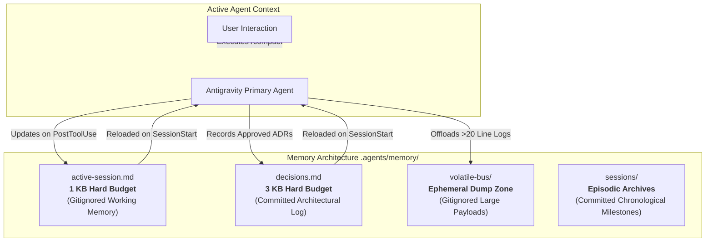

# The AGYToolkit Memory System

## Overview

In long-running autonomous development sessions, large context windows eventually encounter token exhaustion. When developers or agents execute `/compact` or when models truncate context, volatile knowledge (file touchpoints, decisions, active goals) is often erased, forcing agents to re-explore the codebase and repeat mistakes.

AGYToolkit solves this through a **budget-governed, dual-tier memory system** coupled with an ephemeral volatile bus. This guarantees that sessions can be compacted with **zero context loss**.

---

## Memory Architecture



---

## The Four Tiers Explained

### 1. `active-session.md` (Local Working Memory)
- **Path**: `.agents/memory/active-session.md`
- **Git Status**: **Strictly Gitignored**. Each developer or autonomous machine maintains its own active session state without causing merge conflicts.
- **Budget**: **Hard ceiling of 1024 bytes (1 KB)**.
- **Content**:
  - Current Objective & Branch.
  - Active Operational Mode (`FEATURE`, `SPIKE`, or `QUICKFIX`).
  - Active Touchpoints (the 3-5 files currently under modification).
  - Immediate Next Action.
- **Enforcement**: Monitored by `context-budgeter` and validated during `PostToolUse` memory flush hooks. If the file exceeds 1024 bytes, non-essential lines are trimmed automatically.

### 2. `decisions.md` (Project Architectural Memory)
- **Path**: `.agents/memory/decisions.md`
- **Git Status**: **Committed to Version Control**. Shared across all developers, agents, and CI pipelines.
- **Budget**: **Hard ceiling of 3072 bytes (3 KB)**.
- **Content**:
  - Date-stamped architectural decisions.
  - Pattern selections (e.g., Hexagonal Architecture, Zod schema validation).
  - Explicit trade-offs accepted.
  - Pointers to comprehensive ADR documents (`docs/adr/ADR-001-...`).
- **Enforcement**: Only updated when decisions are reviewed or confirmed. Older decisions are summarized or offloaded to ADR documents when approaching the 3 KB threshold.

### 3. `volatile-bus/` (Ephemeral Dump Zone)
- **Path**: `.agents/memory/volatile-bus/`
- **Git Status**: **Strictly Gitignored** (except `.gitignore`).
- **Purpose**: Prevents prompt token depletion.
- **Protocol**:
  - Any compiler output, stack trace, test log, or subagent research dump exceeding **20 lines** must never be printed directly into the chat thread.
  - The agent writes the payload to `.agents/memory/volatile-bus/<timestamp>-<topic>.log`.
  - In the conversation, the agent references only the file path and a 1-line summary.

### 4. `sessions/` (Episodic Archive)
- **Path**: `.agents/memory/sessions/`
- **Git Status**: **Committed to Version Control**.
- **Purpose**: Historical log of completed milestones.
- **Protocol**: When a feature branch is merged or a major milestone is reached, the active session summary is archived as `YYYY-MM-DD-<milestone>.md` in `sessions/`, and `active-session.md` is reset to a clean baseline.

---

## Compaction Defense Protocol

When a conversation history grows and you run `/compact`:

1. **Pre-Compaction**:
   - The agent ensures all recent architectural decisions are recorded in `.agents/memory/decisions.md`.
   - The active task and touched files are confirmed in `.agents/memory/active-session.md`.
2. **Context Compaction**:
   - The LLM summarizer truncates the conversational turns.
3. **Post-Compaction Wakeup**:
   - The agent reads `active-session.md` and `decisions.md` (consuming less than 4 KB combined).
   - The agent immediately knows the active branch, the touched files, and the next steps without needing to ask the user or search the repository.

---

## Programmatic Memory API

AGYToolkit provides a Python memory management library in `agy_toolkit.memory`:

```python
from pathlib import Path
from agy_toolkit.memory import (
    load_active_session,
    write_active_session,
    record_decision,
    offload_volatile_payload,
)

memory_dir = Path(".agents/memory")

# Load session
session = load_active_session(memory_dir)

# Update touchpoint
session.touchpoints.append("src/order/OrderService.java")
write_active_session(memory_dir, session)

# Offload large log
log_path = offload_volatile_payload(
    memory_dir=memory_dir,
    topic="maven-build",
    payload=compiler_output,
)
```
