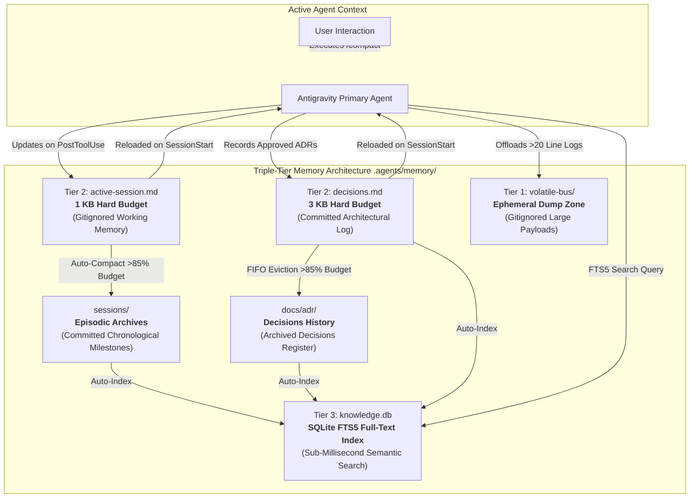

# The AGYToolkit Memory System

## Overview

In long-running autonomous development sessions, large context windows eventually encounter token exhaustion. When developers or agents execute `/compact` or when models truncate context, volatile knowledge (file touchpoints, decisions, active goals) is often erased, forcing agents to re-explore the codebase and repeat mistakes.

AGYToolkit solves this through a **budget-governed, triple-tier memory system** coupled with an ephemeral volatile bus, **dynamic auto-compaction engine**, and **permanent SQLite FTS5 knowledge search index**. This guarantees that sessions can be compacted with **zero context loss** and historical rationale is always searchable in sub-milliseconds.

---

## Memory Architecture



---

## The Core Memory Tiers

### 1. `volatile-bus/` (Tier 1: Ephemeral Dump Zone & IPC)
- **Path**: `.agents/memory/volatile-bus/`
- **Git Status**: **Strictly Gitignored** (except `.gitkeep`).
- **Purpose**: Prevents prompt token depletion and serves as the multi-agent IPC message bus.
- **Protocol**:
  - Any compiler output, stack trace, test log, or subagent research dump exceeding **20 lines** must never be printed directly into the chat thread.
  - Inter-agent messages and handoff events are written as structured JSON envelopes with configurable TTL expiration.

### 2. `active-session.md` (Tier 2: Local Working Memory)
- **Path**: `.agents/memory/active-session.md`
- **Git Status**: **Strictly Gitignored**. Each developer or autonomous machine maintains its own active session state without causing merge conflicts.
- **Budget**: **Hard ceiling of 1024 bytes (1 KB)**.
- **Content**:
  - Current Objective & Branch.
  - Active Operational Mode (`FEATURE`, `SPIKE`, or `QUICKFIX`).
  - Active Touchpoints (the 3-5 files currently under modification).
  - Immediate Next Action.
  - Open Blockers.
- **Enforcement**: Monitored by `context-budgeter` and updated during `PostToolUse` memory flush hooks. If the file exceeds 1024 bytes, non-essential lines are trimmed automatically.

### 3. `decisions.md` (Tier 2: Project Architectural Memory)
- **Path**: `.agents/memory/decisions.md`
- **Git Status**: **Committed to Version Control**. Shared across all developers, agents, and CI pipelines.
- **Budget**: **Hard ceiling of 3072 bytes (3 KB)**.
- **Content**:
  - Date-stamped architectural decisions.
  - Pattern selections (e.g., Hexagonal Architecture, Zod schema validation).
  - Explicit trade-offs accepted.
  - Pointers to comprehensive ADR documents (`docs/adr/ADR-001-...`).
- **Enforcement**: Only updated when decisions are reviewed or confirmed. Older decisions are automatically evicted via FIFO to `docs/adr/decisions-history.md` when approaching the 3 KB threshold.

### 4. `knowledge.db` (Tier 3: Permanent Full-Text Knowledge Index)
- **Path**: `.agents/memory/knowledge.db`
- **Git Status**: **Strictly Gitignored**. Auto-compiled locally.
- **Engine**: Zero-dependency SQLite **FTS5** (Full-Text Search 5) with BM25 ranking and porter stemmer tokenization.
- **Indexed Corpora**:
  - Active architectural decisions (`.agents/memory/decisions.md`).
  - Historical evicted decisions (`docs/adr/decisions-history.md`).
  - Archived sprint sessions (`.agents/memory/sessions/*.md`).
  - Repository rules and documentation (`GEMINI.md`, `AGENTS.md`, `docs/*.md`).
- **Performance**: Sub-millisecond keyword and phrase queries with snippet generation and category filtering.

---

## Dynamic Memory Auto-Compaction & ADR Archival

To prevent agents from crashing context windows or overflowing memory files, AGYToolkit includes an **autonomous auto-compaction engine**:

### Compaction Mechanics
1. **85% Capacity Threshold Rule**:
   - `active-session.md` threshold: **870 bytes** (85% of 1,024 B).
   - `decisions.md` threshold: **2,611 bytes** (85% of 3,072 B).
2. **Active Session Pruning**:
   - Creates a complete snapshot in `.agents/memory/sessions/YYYYMMDD_HHMMSS_session.md`.
   - Extracts discrete structural state: `Active Goal`, `Current Branch`, `Active Agent`, `Immediate Next Step`, and `Open Blockers`.
   - Clears accumulated modified files to `- None (archived to sessions/)`, reducing working memory back to ~250 bytes.
   - Emits actionable guidance advising the agent to run `/compact`.
3. **Decisions Register FIFO Eviction**:
   - When `decisions.md` crosses 2,611 bytes, the oldest decision entries are evicted to `docs/adr/decisions-history.md` until memory usage drops to 60% of budget.
   - Preserves all recent decisions in active working memory while retaining an auditable long-term architectural history.
4. **Automatic Knowledge Index Sync**:
   - When active sessions are archived or decisions are evicted, `auto_compact_memory()` automatically triggers `index_workspace()`, ensuring Tier 3 knowledge remains perfectly synchronized.
5. **Lifecycle Hook Enforcement**:
   - [`.agents/hooks/auto-compact-memory.ps1`](../.agents/hooks/auto-compact-memory.ps1) and `.sh` execute automatically on `PostToolUse` for `write_file`, `edit_file`, and `run_command`.

---

## Memory & Event Bus CLI Commands

AGYToolkit provides CLI commands to govern memory budgets, pass messages across agents, and execute full-text knowledge searches:

### Memory Governance & Knowledge Search
```bash
# Check current memory usage against hard caps (1 KB active-session / 3 KB decisions)
agy-toolkit memory status

# Full-text search across historical ADRs, sessions, and documentation
agy-toolkit memory search "Hexagonal Architecture"

# Search with specific category filter (e.g. ARCH, BUS, SEC, SESSION)
agy-toolkit memory search "volatile bus" --category BUS

# Output search hits in JSON format for agent pipelines
agy-toolkit memory search "rate limiting" --json

# Rebuild or sync the SQLite FTS5 knowledge search index
agy-toolkit memory reindex

# Force full re-index of all documentation and history
agy-toolkit memory reindex --force

# Trigger auto-compaction and ADR archival
agy-toolkit memory auto-compact

# Preview auto-compaction projections without modifying files on disk
agy-toolkit memory auto-compact --dry-run

# Flush working memory and archive state into sessions/ directory
agy-toolkit memory flush

# Record a binding architectural decision
agy-toolkit memory record --category ARCH --decision "Spring Boot microservices must use Hexagonal Architecture."
```

### Multi-Agent Event Bus (IPC)
```bash
# Publish an event to the volatile bus
agy-toolkit bus send --topic review --sender code-reviewer --recipient node-ts-engineer --payload '{"status": "APPROVED", "findings": 0}'

# List active events on the bus
agy-toolkit bus list

# Read and consume events matching a specific topic
agy-toolkit bus read --topic review --consume

# Stream events in real time until timeout or completion
agy-toolkit bus watch --topic review --timeout 30

# Clear all volatile bus payloads
agy-toolkit bus clear
```

---

## Native Model Context Protocol (MCP) Tools

Specialist agents query memory and search long-term architectural knowledge using native MCP tools over standard I/O:

* `agy_memory_search(query: str, category: Optional[str] = None, limit: int = 5)`: Returns ranked search hits with snippet provenance.
* `agy_memory_reindex(force: bool = False)`: Re-indexes workspace documents.
* `agy_memory_status()`: Checks active budget consumption.
* `agy_memory_record(decision: str, category: str = "ARCH")`: Records new architectural decisions within budget.
* `agy_memory_compact(threshold: float = 0.85, dry_run: bool = False)`: Executes auto-compaction.

---

## Programmatic Python API

### Knowledge Search (`agy_toolkit.knowledge`)
```python
from pathlib import Path
from agy_toolkit.knowledge import search_knowledge, index_workspace, get_knowledge_stats

ws = Path.cwd()

# Sync knowledge index
report = index_workspace(ws)
print(f"Indexed {report.indexed_documents} documents in {report.elapsed_ms} ms")

# Search historical decisions and sessions
results = search_knowledge(ws, query="lease timeout", category="BUS", limit=5)
for r in results:
    print(f"[{r.category}] {r.title} ({r.source_file}): {r.snippet}")
```

### Memory Operations (`agy_toolkit.memory`)
```python
from pathlib import Path
from agy_toolkit.memory import (
    check_memory_budgets,
    auto_compact_memory,
    format_compact_report,
    update_active_session,
    flush_active_session,
    record_decision,
)

mem_dir = Path(".agents/memory")

# Check memory health
budgets = check_memory_budgets(mem_dir)
print(budgets["active_session"]["within_budget"])

# Evaluate budgets and auto-compact if over 85% threshold
report = auto_compact_memory(memory_dir=mem_dir, threshold=0.85, dry_run=False)
if report.active_session_compacted or report.decisions_compacted:
    print(format_compact_report(report))
```
