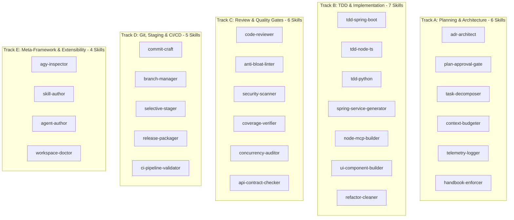

# Progressive SDLC Skills Catalog

## Overview

In Google Antigravity (AGY), skills are progressively loaded procedural playbooks. Rather than consuming prompt tokens at session initiation, skills are loaded dynamically on demand when an agent encounters a specific operational requirement.

AGYToolkit organizes **28 progressive SDLC skills** across 5 engineering tracks. Every skill conforms to strict anti-bloat standards (zero emojis in source code or instructions), includes explicit operational protocols, and features a rigorous quality gate checklist.

---

## Track Breakdown

---

## Detailed Skill Catalog

### Track A: Planning & Architecture (6 Skills)

1. **`adr-architect`**:
   - *Description*: Documents Architecture Decision Records (ADRs) with trade-off matrices and Mermaid diagrams.
   - *When to Use*: When selecting libraries, designing persistence models, or making structural architectural changes.
   - *Trigger*: `/adr`, `/design`, or explicit architecture requests.

2. **`plan-approval-gate`**:
   - *Description*: Structures formal implementation plan artifacts with `RequestFeedback: true` to require user sign-off before code modifications.
   - *When to Use*: Prior to making any code changes or refactoring in `FEATURE` mode.
   - *Trigger*: Start of any new feature or structural task.

3. **`task-decomposer`**:
   - *Description*: Decomposes complex user epics into bite-sized, atomic units of work (<150 lines per change).
   - *When to Use*: When analyzing large feature requests or epics.
   - *Trigger*: Planning sessions, multi-agent task allocations.

4. **`context-budgeter`**:
   - *Description*: Enforces token and byte budgets for session memory files (`active-session.md` <= 1024 bytes, `decisions.md` <= 3072 bytes) and offloads raw logs.
   - *When to Use*: When large logs, traces, or subagent outputs threaten context window limits.
   - *Trigger*: Token usage alerts, pre-compaction hygiene.

5. **`telemetry-logger`**:
   - *Description*: Standardizes cross-agent handoff event logs, test execution durations, and SLA benchmarks.
   - *When to Use*: When recording multi-agent execution sequences or measuring test timings.
   - *Trigger*: Subagent handoffs, pipeline benchmarks.

6. **`handbook-enforcer`**:
   - *Description*: Audits repository operations against guidelines defined in `GEMINI.md` and `AGENTS.md`.
   - *When to Use*: During PR reviews or quality checks.
   - *Trigger*: Pre-commit validation, compliance checks.

---

### Track B: TDD & Implementation (7 Skills)

7. **`tdd-spring-boot`**:
   - *Description*: Red-Green-Refactor TDD for Java 23 / Spring Boot using JUnit 5, Mockito, and AssertJ.
   - *When to Use*: Authoring enterprise backend services, entities, and use cases.
   - *Trigger*: Java backend feature development.

8. **`tdd-node-ts`**:
   - *Description*: Red-Green-Refactor TDD for Node.js and TypeScript using Vitest, Jest, and Supertest.
   - *When to Use*: Authoring TypeScript services, MCP tools, and Express/Fastify routes.
   - *Trigger*: Node.js and TypeScript backend development.

9. **`tdd-python`**:
   - *Description*: Isolated Python 3.12 TDD within virtual environments using `unittest` and `pytest`.
   - *When to Use*: Authoring Python automation scripts, CLI utilities, and data harnesses.
   - *Trigger*: Python module development.

10. **`spring-service-generator`**:
    - *Description*: Scaffolds Hexagonal Architecture service slices (domain models, ports, services, adapters).
    - *When to Use*: Creating new business domain capabilities in Spring Boot projects.
    - *Trigger*: Domain service scaffolding.

11. **`node-mcp-builder`**:
    - *Description*: Builds Model Context Protocol (MCP) servers and tools using TypeScript and the official MCP SDK.
    - *When to Use*: Exposing local APIs, browser automation, or custom tools to AI agents.
    - *Trigger*: MCP server development.

12. **`ui-component-builder`**:
    - *Description*: Builds accessible (WCAG 2.1 AA), responsive, and typed UI components using React, TypeScript, and Tailwind CSS.
    - *When to Use*: Developing web frontend components, dialogs, and design systems.
    - *Trigger*: Frontend development.

13. **`refactor-cleaner`**:
    - *Description*: Conducts structural code refactoring, splits monolithic files (>600 lines), and eliminates dead code.
    - *When to Use*: Addressing technical debt, pruning legacy branches, and reducing file sizes.
    - *Trigger*: Code hygiene audits, pre-merge refactoring.

---

### Track C: Review & Quality Gates (6 Skills)

14. **`code-reviewer`**:
    - *Description*: Performs senior engineering reviews on git diffs for logic bugs, boundary cases, and security vulnerabilities.
    - *When to Use*: Before staging changes or opening a pull request.
    - *Trigger*: `/review`, pre-staging gate.

15. **`anti-bloat-linter`**:
    - *Description*: Scans modified files for AI-generated clutter, emojis, conversational comments, and oversized files.
    - *When to Use*: PreToolUse and pre-commit checks.
    - *Trigger*: Automated git hook execution.

16. **`security-scanner`**:
    - *Description*: Audits for hardcoded secrets, API tokens, OWASP Top 10 vulnerabilities, and dependency CVEs.
    - *When to Use*: Before staging code, after adding new third-party libraries.
    - *Trigger*: Pre-release audits, security gate.

17. **`coverage-verifier`**:
    - *Description*: Enforces the mandatory 80%+ line and branch test coverage threshold before staging.
    - *When to Use*: After running test suites to confirm coverage compliance.
    - *Trigger*: Pre-staging test verification.

18. **`concurrency-auditor`**:
    - *Description*: Audits multi-threaded logic, async promises, atomic references, and resource handle leaks.
    - *When to Use*: When reviewing high-throughput services, scheduled jobs, or WebSocket pipelines.
    - *Trigger*: Concurrency reviews.

19. **`api-contract-checker`**:
    - *Description*: Validates OpenAPI specs, JSON Schema models, and DTO backward-compatibility to prevent breaking changes.
    - *When to Use*: Modifying public HTTP or RPC endpoints.
    - *Trigger*: API modifications.

---

### Track D: Git, Staging & CI/CD (5 Skills)

20. **`commit-craft`**:
    - *Description*: Drafts atomic Conventional Commits (`<type>(<scope>): 
`) based on staged diffs.
    - *When to Use*: Preparing commits for review and staging.
    - *Trigger*: `/commit`, git staging completion.

21. **`branch-manager`**:
    - *Description*: Enforces branch isolation (`feature/<name>`, `fix/<name>`, `spike/<name>`) and blocks direct work on `main`.
    - *When to Use*: Starting new tasks, synchronizing branches with upstream.
    - *Trigger*: Task initiation.

22. **`selective-stager`**:
    - *Description*: Manages granular, file-level staging (`git add`) and presents diff summaries for user sign-off.
    - *When to Use*: Prior to committing verified changes.
    - *Trigger*: Staging gate.

23. **`release-packager`**:
    - *Description*: Computes semantic version bumps (SemVer), updates `CHANGELOG.md`, and builds distribution bundles.
    - *When to Use*: Preparing tagged releases and release candidates.
    - *Trigger*: Release preparation.

24. **`ci-pipeline-validator`**:
    - *Description*: Audits CI/CD workflows (GitHub Actions, GitLab CI) for deterministic steps, caching, and least-privilege permissions.
    - *When to Use*: Configuring or updating automated build pipelines.
    - *Trigger*: CI configuration audits.

---

### Track E: Meta-Framework & Extensibility (4 Skills)

25. **`agy-inspector`**:
    - *Description*: Audits and catalogs registered AGY tools, skills, rules, hooks, and MCP servers in the environment.
    - *When to Use*: Initial workspace assessment, tool availability diagnostics.
    - *Trigger*: Workspace onboarding, readiness check.

26. **`skill-author`**:
    - *Description*: Dynamically generates project-specific domain skills on demand inside target workspaces (e.g., ADB device tapping, trading indicators, email triage) without polluting the core framework.
    - *When to Use*: When a target project requires custom operational playbooks.
    - *Trigger*: Domain playbook authoring.

27. **`agent-author`**:
    - *Description*: Dynamically generates project-specific specialist subagents on demand inside target workspaces using AGY hybrid Markdown specifications.
    - *When to Use*: When a project requires unique subagent roles with dedicated tool access or workspaces.
    - *Trigger*: Custom subagent creation.

28. **`workspace-doctor`**:
    - *Description*: Diagnoses workspace health, validates runtime installations (Node, Java, Maven, Python), and verifies AGY compliance.
    - *When to Use*: Environment setup, troubleshooting failing hooks or tools.
    - *Trigger*: Health audits, diagnostic troubleshooting.
