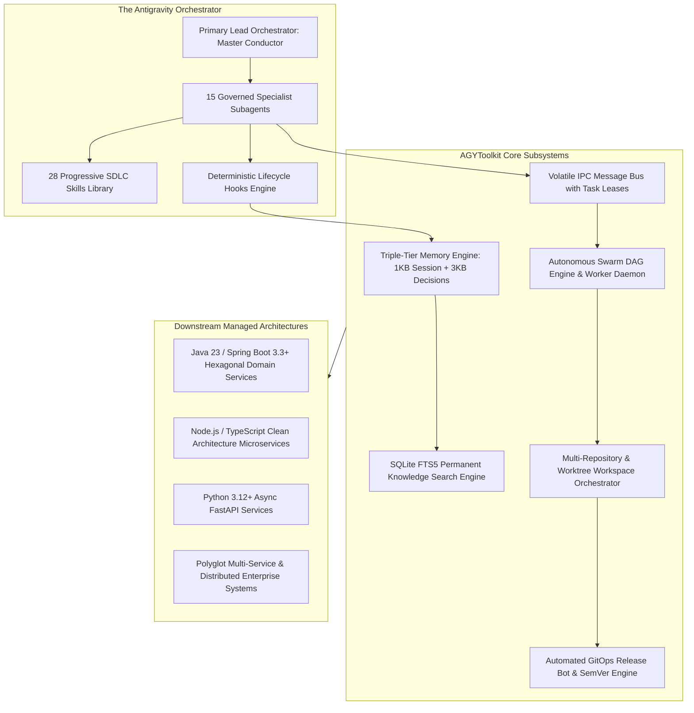
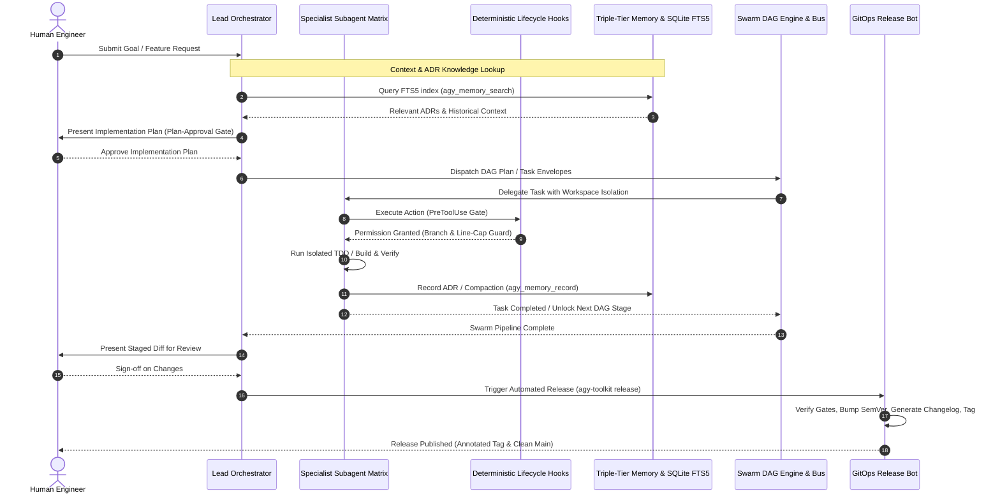

# AGYToolkit 1.0 Master Architecture & Operating Guide

> **The Sovereign Multi-Agent Software Development Lifecycle (SDLC) Operating System for Google Antigravity (AGY).**

---

## 1. Executive Summary & Mission

`AGYToolkit` provides an enterprise-grade governance engine, memory architecture, and autonomous swarm orchestrator for Google Antigravity agents. It eliminates "AI chaos" -- uncontrolled monolithic file writes, context amnesia, broken test suites, and direct commits to production branches -- by wrapping agent interactions in deterministic quality gates and verifiable operational protocols.

---

## 2. Core Governance Architecture

---

## 3. The 9 Core Governance Pillars

### Pillar 1: Universal 15 Specialist Subagents Matrix
Operates under the Single Responsibility Principle with strict handoff boundaries:
1. `orchestrator`: Master Project Conductor and sole human interface.
2. `planner-architect`: System design, ADRs, domain models, and API contracts.
3. `spring-boot-engineer`: Java 23 / Spring Boot 3.3+ Hexagonal domain services.
4. `node-ts-engineer`: Node.js / TypeScript microservices and MCP sidecars.
5. `python-automation-lead`: Python 3.12 async services, CLI, and test harnesses.
6. `frontend-ui-engineer`: Modern responsive UI components and frontend state.
7. `database-architect`: Relational schemas, Flyway migrations, and indexing.
8. `tdd-specialist`: Test-Driven Development harnesses and Testcontainers.
9. `security-auditor`: Authentication, input validation, and secret sanitization.
10. `code-reviewer`: Deep code review, static analysis, and bug detection.
11. `anti-bloat-sentinel`: Enforces <600 line limit, zero emojis, and zero AI chatter.
12. `git-craftsman`: Atomic Conventional Commits and feature branch management.
13. `docs-librarian`: Technical architecture documentation and API references.
14. `context-budget-guard`: Token conservation and memory budget enforcement.
15. `dependency-curator`: Dependency vulnerability scanning and version management.

### Pillar 2: 28 Progressive SDLC Skills Library
Organized into 5 engineering tracks: Planning & Architecture, TDD & Implementation, Review & Quality Gates, Git & CI/CD, and Meta-Framework Extensibility.

### Pillar 3: Deterministic Lifecycle Hooks (`hooks.json`)
Executes before and after tool calls (`PreToolUse`, `PostToolUse`, `SessionStart`). Hard-blocks direct commits to `main`, unapproved modifications, failing test runs, and commits containing plaintext secrets, cloud credentials, private keys, host filesystem paths, or sensitive `.env` files via the native `secret-leak-sentinel`.

### Pillar 4: Anti-Bloat Sentinel
- Zero emojis in production code, configs, scripts, comments, logs, and commit messages.
- Elimination of conversational AI chatter in source comments.
- Strict file line cap (<600 lines per file) enforced across code, configs, migrations, and scripts.

### Pillar 5: Budget-Governed Triple-Tier Memory Engine & SQLite FTS5 Index
- Tier 1: `active-session.md` (1 KB hard budget for working context).
- Tier 2: `decisions.md` (3 KB hard budget for committed architectural decisions).
- Tier 3: `knowledge.db` (Zero-dependency SQLite FTS5 full-text search engine).
- Auto-Compactor archives sessions to `.agents/memory/sessions/` and evicts older decisions via FIFO to `docs/adr/decisions-history.md`.

### Pillar 6: Volatile IPC Multi-Agent Event Bus & Self-Healing Leases
Non-persistent inter-agent communication channel supporting atomic task claims, heartbeat renewals, and crash recovery.

### Pillar 7: Autonomous Swarm Choreography & Declarative DAG Engine
Coordinates multi-step autonomous workflows across specialist subagents with automated dependency unlocking and background worker daemons (`agy-toolkit swarm worker`).

### Pillar 8: Multi-Repository & Worktree Swarm Orchestrator (`agy-workspace.json`)
Auto-discovers child repositories, detects technology stacks (`spring-boot`, `node-ts`, `python`), assigns architectural roles (`backend`, `frontend`), bridges cross-repo event buses, and coordinates multi-service DAGs.

### Pillar 9: Automated GitOps Lifecycle & Release Bot (`release`)
One-command release execution (`agy-toolkit release patch|minor|major`): enforces clean working tree, branch guard (`main`), and test verification gate; parses Conventional Commits; auto-generates `CHANGELOG.md`; synchronizes SemVer across metadata; and creates annotated git tags.

---

## 4. AGYToolkit SDLC Orchestration Lifecycle

The end-to-end operational sequence of how AGYToolkit governs and executes tasks:

---

## 5. Complete Native MCP Tool Catalog (23 Tools)

| Tool Name | Subsystem | Description |
| :--- | :--- | :--- |
| `agy_doctor` | Governance | Environment health and compliance auditor |
| `agy_memory_status` | Memory | Check memory budget consumption |
| `agy_memory_record` | Memory | Record binding architectural decision |
| `agy_memory_compact` | Memory | Force or evaluate auto-compaction |
| `agy_memory_search` | Knowledge | Sub-millisecond FTS5 search across ADRs and sessions |
| `agy_memory_reindex` | Knowledge | Rebuild SQLite FTS5 permanent search index |
| `agy_bus_send` | Event Bus | Publish event envelope to volatile bus |
| `agy_bus_read` | Event Bus | List active non-expired bus events |
| `agy_bus_claim` | Event Bus | Atomically claim event with lease duration |
| `agy_bus_heartbeat` | Event Bus | Extend active lease duration |
| `agy_bus_reclaim` | Event Bus | Sweep and recover expired or orphaned claims |
| `agy_swarm_run` | Swarm | Launch multi-agent DAG pipeline run |
| `agy_swarm_status` | Swarm | Query DAG execution topology and step states |
| `agy_swarm_advance` | Swarm | Advance step and unlock downstream dependencies |
| `agy_swarm_cancel` | Swarm | Cancel active DAG pipeline run |
| `agy_swarm_worker_cycle` | Swarm | Run single atomic worker claim sweep |
| `agy_swarm_worker_status` | Swarm | Inspect worker readiness and unassigned tasks |
| `agy_workspace_status` | Multi-Repo | Query workspace topology and member health |
| `agy_swarm_multi_run` | Multi-Repo | Launch cross-repository swarm pipeline run |
| `agy_swarm_multi_status` | Multi-Repo | Query cross-repository progress card |
| `agy_release_plan` | Release | Preview release plan and changelog diff |
| `agy_release_create` | Release | Execute automated GitOps release pipeline |
| `agy_update` | Distribution | Non-destructively refresh downstream workspace |

---

## 6. Human-in-the-Loop Operational Safeguards

1. **Plan-Approval Gate**: No code modifications permitted without user-reviewed plan artifacts.
2. **Atomic Verification**: Changes tested in isolated virtual environments before staging.
3. **Selective Staging**: Only verified files are staged; local registers remain untracked.
4. **Final Review Gate**: Staged diffs presented for explicit human sign-off before committing.
